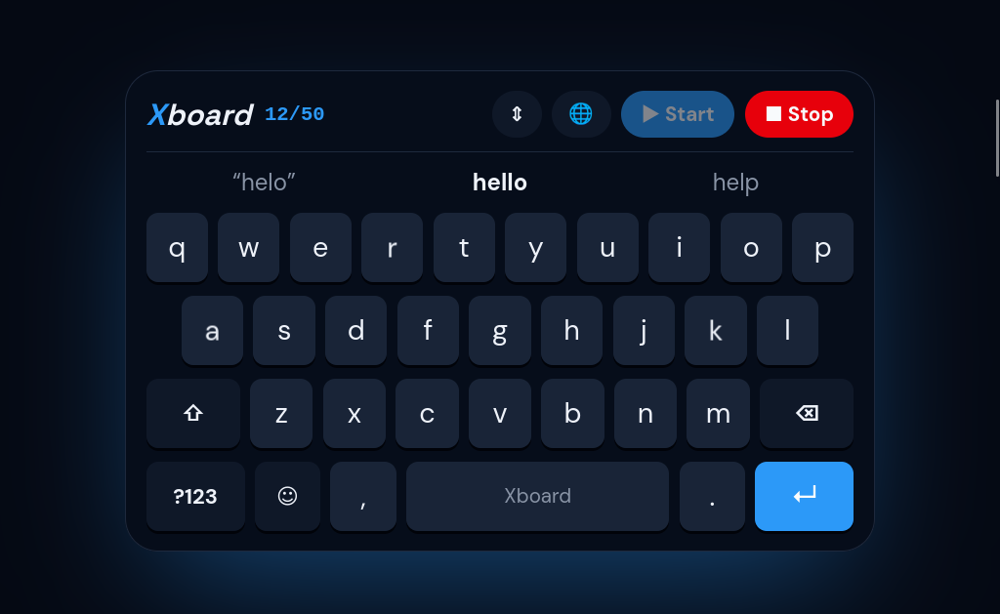

# XBoard

  <strong>A fast, lightweight, and modern Android board experience built for smooth performance.</strong>

---

## ✨ Features

| Feature | Description |
| :--- | :--- |
| ⚡ **Fast & Lightweight** | Optimized for smooth responsiveness and low resource usage. |
| 🎨 **Clean Interface** | Distraction-free layout designed for everyday usability. |
| 📦 **Ready Out of the Box** | Pre-built APK releases ready to install in seconds—no setup required. |
| 🔒 **Privacy Focused** | No unnecessary bloat or background tracking. |

---

## 📥 Installation

> [!TIP]
> Always download the **latest release** to get the newest features, UI improvements, and bug fixes.

1. Open the **[Releases Page](https://github.com/hanifssh/Xboard/releases/tag/v1.0.1)**.
2. Scroll down to the **Assets** section of the latest release.
3. Tap and download the **`XBoard.apk`** file onto your Android device.
4. Open the downloaded `.apk` file and tap **Install**.

> [!NOTE]
> If your device blocks the installation, go to **Settings → Security** (or tap **Settings** on the prompt) and enable **Install unknown apps** for your browser or file manager.

---

## 📸 Preview

  

---

##  ⭐ **Star this repository** if you find XBoard useful!

---

  Made with ❤️ for the community

